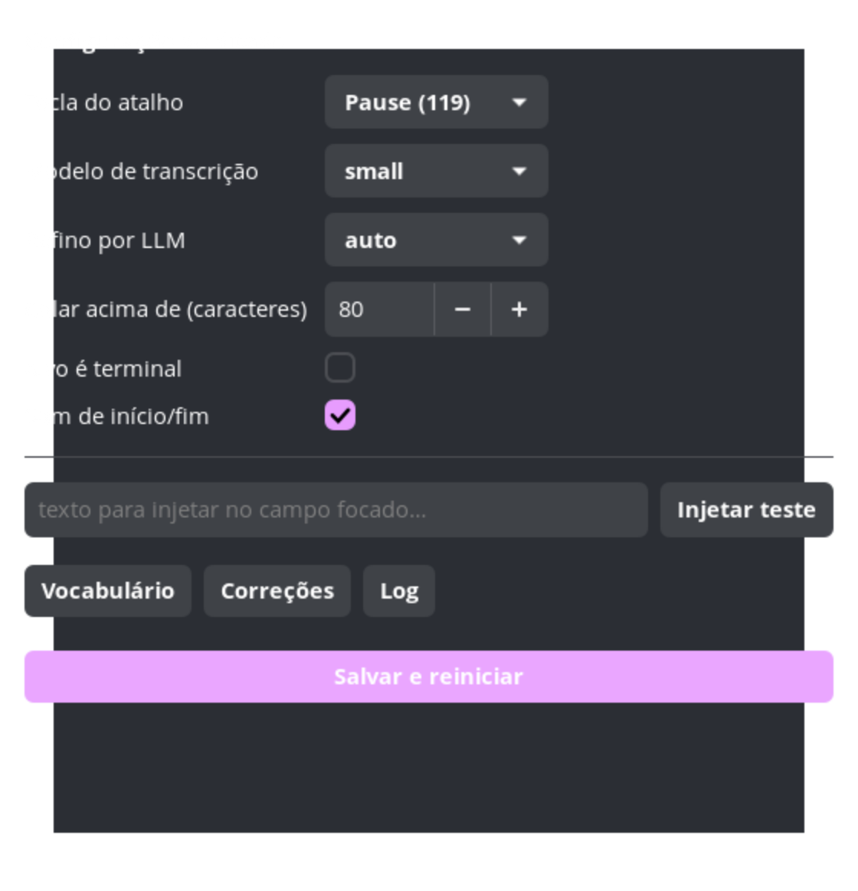

# voice-typer

Ditado por voz para **qualquer aplicativo** no Linux. Você aperta uma tecla, fala,
aperta de novo — e o texto aparece no campo focado, com acentuação e pontuação.

Funciona em WhatsApp Web, Slack, VS Code, navegadores, aplicativos Electron e
terminais, porque injeta texto no nível do sistema em vez de integrar com cada app.

```
Pause  →  fala  →  Pause  →  texto no campo focado
```

Transcrição **local** (faster-whisper em CPU), sem enviar áudio para servidor.
O refino por LLM é opcional e plugável.

## Índice

- [Recursos](#recursos)
- [Ambiente validado](#ambiente-validado)
- [Requisitos](#requisitos)
- [Capturas](#capturas)
- [Instalação](#instalação)
- [Uso](#uso)
- [Configuração](#configuração)
- [Como funciona](#como-funciona)
- [Desempenho](#desempenho)
- [Solução de problemas](#solução-de-problemas)
- [Desenvolvimento](#desenvolvimento)
- [Limitações](#limitações)
- [Contribuindo](#contribuindo)
- [Licença](#licença)

## Recursos

| Recurso | Detalhe |
| --- | --- |
| Atalho global | Lido de `/dev/input` — funciona com qualquer janela em foco |
| Transcrição local | faster-whisper `small` em int8 na CPU (~3 s para 12 s de fala) |
| Injeção universal | `wtype` (Unicode literal) ou colagem — sem dependência de layout |
| Três modos de qualidade | vocabulário (`hotwords`), correções locais e refino opcional por LLM |
| Interface gráfica | Ícone de bandeja com estado, mais janela de configuração (GTK3) |
| Serviço de usuário | Sobe no login via systemd |
| Pacote `.deb` | Autocontido, sem rede na instalação |

## Ambiente validado

O desenvolvimento e todos os números deste README vêm de uma única máquina. Se
você usa outro ambiente, trate como **não validado** — pode funcionar, mas ninguém
verificou.

| Item | Valor |
| --- | --- |
| Distribuição | Pop!_OS 24.04 LTS, kernel 7.1.5 |
| Sessão | Wayland (`XDG_SESSION_TYPE=wayland`) |
| Compositor | **COSMIC** (`cosmic-comp 1.0.0`) |
| CPU | Intel i5-1135G7 (4 núcleos / 8 threads, AVX512_VNNI) |
| GPU | Intel Iris Xe — **sem CUDA**, transcrição é CPU-only |
| Python | 3.12.3 (sistema) · venv para o faster-whisper |
| GTK | 3.24 (interface gráfica) |
| ffmpeg | 6.1.1 |
| Terminais testados | kitty 0.49.2, cosmic-term 1.9.0 |

### O que é sensível ao ambiente

- **Injeção de texto** depende de `zwp_virtual_keyboard_v1`. COSMIC expõe esse
  protocolo (verificado); GNOME e KDE não foram testados, e o suporte varia.
- **Atalho global** lê `/dev/input` diretamente, então independe do compositor —
  mas exige o grupo `input`.
- **Atalho de colar** difere por terminal: `Ctrl+Shift+V` na maioria,
  `Ctrl+V` em aplicativos gráficos. Daí a opção `--terminal`.
- **Desempenho** é da CPU. Sem GPU não há aceleração; os tempos da seção
  [Desempenho](#desempenho) refletem um i5 de 11ª geração com o desktop ocupado.

Se você testar em outra combinação, uma issue com a saída de `voice-typer --doctor`
e a linha de `~/.local/state/voice-typer/dictations.jsonl` é a informação mais
útil possível.

## Requisitos

- Linux com **Wayland** (testado em COSMIC; o `wtype` exige
  `zwp_virtual_keyboard_v1`)
- Python 3.10+
- Grupo `input` (o instalador adiciona; para rodar da fonte, veja abaixo)
- Pacotes: `wtype`, `wl-clipboard`, `ffmpeg`, `libnotify-bin`,
  `pipewire-bin` ou `pulseaudio-utils`
- Para a interface gráfica: `python3-gi`, `gir1.2-gtk-3.0`,
  `gir1.2-appindicator3-0.1`

## Capturas

| Configuração | Ícone |
| --- | --- |
|  |  |

As imagens são geradas por `docs/capture-screenshots.py`, que renderiza a janela
real fora da tela (`Gtk.OffscreenWindow`) — reproduzível e sem capturar nada além
do próprio aplicativo. Regenere após mudanças na interface.

## Instalação

### Pacote `.deb`

```bash
sudo apt install ./voice-typer_1.0.0_amd64.deb
newgrp input            # ou encerre e abra a sessão
systemctl --user daemon-reload
systemctl --user start voice-typer
```

O pacote instala em `/opt/voice-typer`, cria os comandos `voice-typer` e
`voice-typer-gui`, registra o item na gaveta de aplicativos e habilita o serviço
no login. Inclui o ambiente Python pronto, então **não precisa de rede**.

### A partir do código

```bash
git clone <repo> && cd voice-typer
uv venv .venv --python /usr/bin/python3.12
uv pip install --python .venv/bin/python faster-whisper

sudo usermod -aG input "$USER"      # e refaça o login
python3 dictate.py --doctor         # confirma que tudo está no lugar
python3 dictate.py
```

## Uso

### Comando principal

```bash
voice-typer                  # daemon: aperte Pause para começar/parar
voice-typer --refine         # com refino por LLM (só quando o texto pede)
voice-typer --refine always  # refino em toda ditada
voice-typer --terminal       # alvo é terminal (colar usa Ctrl+Shift+V)
voice-typer --dry-run        # transcreve mas não injeta
voice-typer --doctor         # verifica a stack inteira
```

### Interface gráfica

```bash
voice-typer-gui              # ícone de bandeja + configuração
```

A bandeja mostra o estado (pronto / gravando / transcrevendo) e dá acesso a
configuração, vocabulário, correções e log. Usa bandeja de propósito: uma janela
flutuante roubaria foco e o texto iria para ela em vez do campo do usuário.

### Serviço

```bash
systemctl --user status voice-typer        # estado
systemctl --user restart voice-typer       # após editar configuração
journalctl --user -u voice-typer -f        # acompanhar as ditadas
systemctl --user disable --now voice-typer # tirar do login
```

## Configuração

### `settings.json`

Precedência: `~/.config/voice-typer/settings.json`, depois o do projeto.
A interface gráfica grava no primeiro.

```json
{
  "key": 119,
  "model": "small",
  "language": "pt",
  "refine": "auto",
  "paste_above": 80,
  "method": "auto",
  "terminal": false,
  "no_sound": false,
  "delay": 15
}
```

| Campo | Significado |
| --- | --- |
| `key` | keycode do atalho (119 = Pause, 70 = ScrollLock, 97 = RightCtrl) |
| `model` | `tiny`, `base`, `small`, `medium`, `large-v3-turbo` |
| `refine` | `never`, `auto` (só com sinal de problema), `always` |
| `paste_above` | acima deste tamanho cola em vez de digitar |
| `terminal` | alvo é terminal — muda o atalho de colar |

Para descobrir o keycode de uma tecla: `python3 detect_key.py`.

### `vocabulary.txt` — enviesa o modelo

Uma expressão por linha. Vai como `hotwords` para o decodificador. Use para nomes
próprios, jargão e termos técnicos. Não custa latência.

Seus termos pessoais ficam em `~/.config/voice-typer/vocabulary.txt` e são
combinados com o do projeto — configuração pessoal não precisa ser versionada.

### `corrections.txt` — corrige depois

```
nota fiscal => nota fiscal                      # literal
re:\b(?:e\s+)?t(?:enho|endo|em)\s+vista\s+que\b => tendo em vista que   # regex
```

Linhas com `re:` são regex; as demais são literais com fronteira de palavra. A
caixa do original é preservada.

Assim como o vocabulário, regras pessoais vão em
`~/.config/voice-typer/corrections.txt`.

### `llm.env` — refino opcional

```bash
mkdir -p ~/.config/voice-typer
cp llm.env.example ~/.config/voice-typer/llm.env
chmod 600 ~/.config/voice-typer/llm.env
```

Qualquer endpoint compatível com a API da OpenAI serve: DeepSeek, OpenAI, Groq,
OpenRouter, Ollama local ou llama.cpp.

```
VT_LLM_BASE_URL=https://api.deepseek.com
VT_LLM_MODEL=deepseek-chat
VT_LLM_API_KEY=sua-chave
VT_LLM_TIMEOUT=20
```

Sem este arquivo o ditado funciona normalmente — apenas não há refino.

## Como funciona

```
microfone ──► WAV 16 kHz ──► faster-whisper ──► hotwords ──► correções ──► refino
                                                                              │
                                    campo focado ◄── colar ou digitar ◄────────┘
```

Quatro camadas de qualidade, cada uma cobrindo o que a anterior não alcança:

1. **Vocabulário** (`hotwords`) — atua antes do erro, sem custo
2. **Correções locais** — erro sistemático, determinístico e auditável
3. **Refino por LLM** — erro imprevisível que depende de contexto
4. **Colagem** — acima de ~80 caracteres, evita perda de caracteres na digitação

### Decisões que vieram de medição

**Colar em vez de digitar em textos longos.** Digitar emite ~125 eventos de
teclado por segundo; aplicativos Electron perdem eventos nessa taxa e o sintoma é
letra faltando no meio da palavra. Colar é atômico. Medido: transcrição e texto
final saíram byte a byte idênticos com colagem.

**Desligar raciocínio do LLM.** Modelos de raciocínio gastavam o orçamento de
tokens "pensando" e devolviam resposta vazia. Com `reasoning: {enabled: false}` a
mesma tarefa caiu de 19 s para **~2 s**, com qualidade igual ou melhor.

**`cpu_threads=4`, não 8.** Medido: 2 threads → 2,72 s; 4 → 2,44 s; 8 → 3,02 s.
Oversubscrição piora, porque as threads lógicas disputam CPU com o desktop.

**Não depender do PyAV.** O caminho `transcribe("arquivo.wav")` do faster-whisper
usa uma API de PyAV removida nas versões novas, sem wheel para Python recente.
O áudio é decodificado aqui e passado como `numpy` — que é o formato que o Whisper
consome de qualquer forma.

**Detecção de teclado por capacidade.** Filtrar `/dev/input` pelo handler `kbd`
perde dispositivos criados via `uinput`. A checagem usa `EVIOCGBIT` (`EV_KEY` +
`KEY_A`), o que também reduz a leitura a apenas teclados reais.

**Saturação medida por corridas.** Pico alto sozinho não distingue saturação de um
transiente de abertura de stream. `clip_stats` conta sequências de 3+ amostras em
fundo de escala — a assinatura física de clipping.

**Grupo `input` vem do `sg`.** Um serviço systemd de usuário herda os grupos do
gerenciador de sessão, que pode ter iniciado antes de o usuário entrar no grupo.
`SupplementaryGroups=input` na unidade não resolve (o gerenciador recusa mudar
credenciais); o daemon se re-executa com `sg input -c ...` quando detecta a falta.

## Desempenho

Medições em i5-1135G7 (4 núcleos, AVX512_VNNI), CPU-only, desktop carregado:

| Modelo | 11,8 s de áudio | RTF | Comentário |
| --- | --- | --- | --- |
| `small` | **2,5–3,6 s** | 0,21–0,30 | escolha padrão |
| `large-v3-turbo` | 6,9–10,7 s | 0,59–0,91 | lento demais para ditado |
| `medium` | 10,3 s | 0,88 | dominado pelos dois acima |

Existe um custo fixo de ~1,6 s (o encoder processa janelas de 30 s) mais ~0,13 s
por segundo de áudio. Na prática, ditado de 5 a 15 s responde em 2 a 4 s, e o
teto de 30 s do modelo define a fala máxima útil por captura.

Refino por LLM: ~2 s por chamada, com raciocínio desligado.

## Solução de problemas

Comece por:

```bash
voice-typer --doctor
```

Ele verifica teclados, `/dev/uinput`, captura de áudio (com medição de nível e
clipping), faster-whisper, regras, vocabulário, roteador de LLM e atalho — e aponta
em qual camada está o problema.

| Sintoma | Causa provável | Solução |
| --- | --- | --- |
| "nenhum teclado encontrado" | fora do grupo `input` | `newgrp input` ou refaça o login |
| "áudio praticamente mudo" | microfone errado ou mutado | `pactl list short sources` |
| "áudio saturado" | ganho alto demais | `pactl set-source-volume @DEFAULT_SOURCE@ 60%` |
| Letras faltando em palavras | digitação rápida demais | `--method paste` ou `--paste-above 0` |
| `refino: ignorado` | ver o motivo na mensagem | chave ausente, rede, ou resposta suspeita |
| Texto no lugar errado | foco mudou durante a gravação | não troque de janela enquanto fala |

**Vazamento do `Pause` em terminal.** Como o atalho é lido sem capturar o teclado,
a tecla também chega ao aplicativo. Em terminal o `Pause` vira a sequência
`ESC[57362u`: TUIs consomem e ignoram, mas um `read` cru veria 8 bytes. Se
incomodar, use outra tecla.

**Log de ditados** em `~/.local/state/voice-typer/dictations.jsonl`, com
transcrição, método, se o refino aplicou e por quê. Desligue com `--no-log` se não
quiser seus ditados em disco.

## Desenvolvimento

```bash
uv venv .venv --python /usr/bin/python3.12
uv pip install --python .venv/bin/python faster-whisper

./check.sh             # injetor: lógica, ambiente e captura real
./check-hotkey.sh      # atalho: estado, /dev/uinput e ponta a ponta
./check-dictate.sh     # ditado completo (4 camadas, 68 testes)
./check-no-secrets.sh  # rode antes de cada push
```

`fakekey.py` cria um teclado sintético via `uinput`, então os testes de atalho não
dependem de alguém apertar teclas.

Gerar o pacote:

```bash
./packaging/build.sh 1.0.0
```

| Arquivo | Papel |
| --- | --- |
| `dictate.py` | daemon: atalho, captura, orquestração, injeção |
| `stt.py` | transcrição local (faster-whisper via numpy) |
| `record.py` | captura de áudio e medição de nível/clipping |
| `inject.py` | injeção de texto (`wtype` ou colagem) |
| `refine.py` | refino por LLM com falha aberta |
| `correct.py` | correções literais e regex |
| `detect_key.py` | descobre keycodes para escolher o atalho |
| `voice_typer_gui.py` | interface GTK3 e bandeja |
| `fakekey.py` | teclado sintético para testes |
| `bench.py` | benchmark de modelos |
| `packaging/` | build do `.deb` |

## Limitações

- **Wayland apenas, e validado só em COSMIC.** A injeção usa
  `zwp_virtual_keyboard_v1`; outros compositores não foram testados.
- **CPU-only.** Sem aceleração por GPU; os tempos são de um i5 de 11ª geração.
- **Sem detecção de campo de senha.** O texto é inserido mesmo em campos sensíveis;
  evite ditar com foco em um.
- **Sem plano B para apps que rejeitem teclado virtual.** Uma engine IBus própria
  resolveria; não implementado.
- **Foco não é gerenciado.** Se você trocar de janela durante a transcrição, o texto
  pode ir para o lugar errado.
- **Um ditado por captura.** O modelo usa janelas de 30 s; falas mais longas ficam
  menos precisas — divida em partes.
- **`.deb` de 88 MB** por incluir o ambiente Python completo (428 MB instalado).

## Contribuindo

Veja [CONTRIBUTING.md](CONTRIBUTING.md): como preparar o ambiente, rodar as
verificações, os princípios do projeto e o que incluir ao reportar um problema.

## Licença

MIT — veja [LICENSE](LICENSE).
